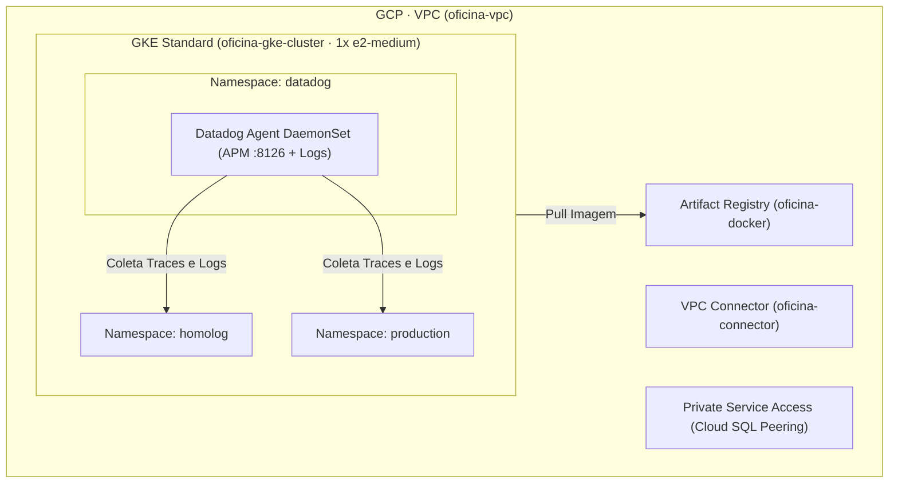

# Oficina Mecânica - Infraestrutura GKE e Rede

[](https://sonarcloud.io/summary/new_code?id=jcontiero_oficina-k8s-infra)
[](https://sonarcloud.io/summary/new_code?id=jcontiero_oficina-k8s-infra)

## Propósito

Este repositório provisiona a camada de plataforma compartilhada de rede e orquestração de containers na Google Cloud Platform (GCP):
- **VPC (`oficina-vpc`)**, sub-redes secundárias para Pods/Services, **Serverless VPC Access Connector (`oficina-connector`)** e **Private Service Access** para o Cloud SQL.
- **Google Kubernetes Engine (`oficina-gke-cluster`)** em modo Standard (`node_count = 1`, `machine_type = "e2-medium"`, Workload Identity habilitado).
- **Artifact Registry (`oficina-docker`)** para armazenamento das imagens Docker dos serviços.
- **Datadog Agent** instalado via Helm release no namespace `datadog` com coleta de logs e APM (`hostPort: 8126`, site `us5.datadoghq.com`).

## Propriedade do State Terraform

- **Backend GCS:** `gs://pos-fiap-2026-tf-state`
- **Prefixo:** `env/shared/k8s-infra`
- **Workspace canônico:** `main` (único dono dos recursos compartilhados de plataforma).
- **Regra de isolamento:** A branch `homolog` executa apenas validação e `terraform plan` sobre o workspace `main`; nunca cria um segundo workspace para não duplicar VPC, GKE ou Artifact Registry. O `terraform apply` ocorre exclusivamente após merge na branch `main` (GitHub Environment `production`) com execução serializada (`concurrency`).

## Pré-requisitos e Variáveis

- Terraform `>= 1.9.0`
- Autenticação GCP (`gcloud auth application-default login` localmente ou Workload Identity Federation no GitHub Actions).
- Segredo `DATADOG_API_KEY` configurado no GitHub Actions (injetado via `TF_VAR_datadog_api_key`).

| Variável | Default | Descrição |
| :--- | :--- | :--- |
| `project_id` | `pos-fiap-2026` | ID do projeto GCP |
| `region` | `us-east1` | Região dos recursos |
| `cluster_name` | `oficina-gke-cluster` | Nome do cluster GKE Standard |
| `vpc_name` | `oficina-vpc` | Nome da VPC compartilhada |
| `datadog_site` | `us5.datadoghq.com` | Site da organização Datadog |
| `datadog_api_key` | *(sensível)* | Chave de API do Datadog Agent |

## Passos para Execução e Deploy

### Execução Local (a partir da pasta `infra/`)

```bash
cd infra
gcloud auth application-default login
terraform init
terraform workspace select main
export TF_VAR_datadog_api_key="SUA_CHAVE_DATADOG"
terraform plan -var-file="environments/main.tfvars"
```

### Deploy Automatizado (CI/CD)

1. Pull Requests e pushes em `homolog` executam `terraform fmt -check`, `terraform validate`, SonarCloud Scan e `terraform plan`.
2. Merges na `main` executam `terraform plan` seguido de `terraform apply -auto-approve -var-file="environments/main.tfvars"` no ambiente `production`.

### Rollback

1. Reverter o commit na branch `main` via Pull Request para restaurar a definição anterior dos módulos e reaplicar o state no workspace `main`.
2. Caso o Helm release do Datadog apresente falha isolada, é possível inspecionar revisões com `helm history datadog -n datadog` e reverter via Terraform ajustando o módulo `infra/modules/datadog`.

## Diagrama de Arquitetura



## Repositórios Relacionados

- [oficina-api](https://github.com/jcontiero/oficina-api) — OS Service e Orquestrador Saga
- [oficina-database-infra](https://github.com/jcontiero/oficina-database-infra) — Cloud SQL e Secret Manager
- [oficina-serverless](https://github.com/jcontiero/oficina-serverless) — Cloud Functions (Auth / Notificações), Pub/Sub e API Gateway
